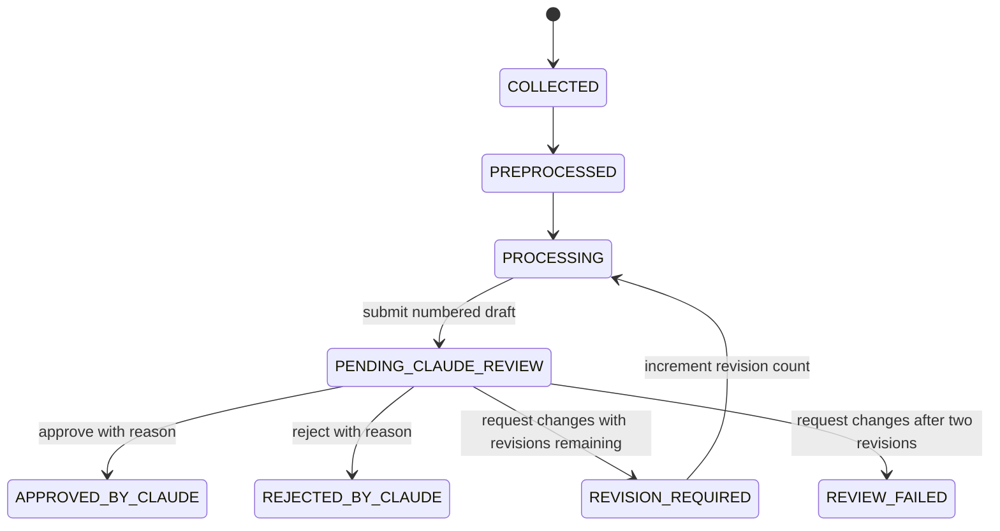
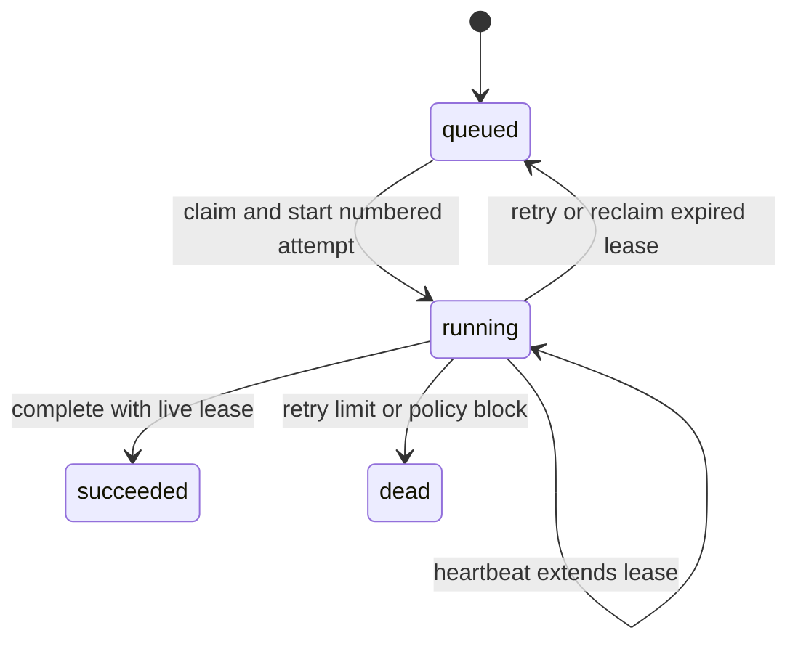
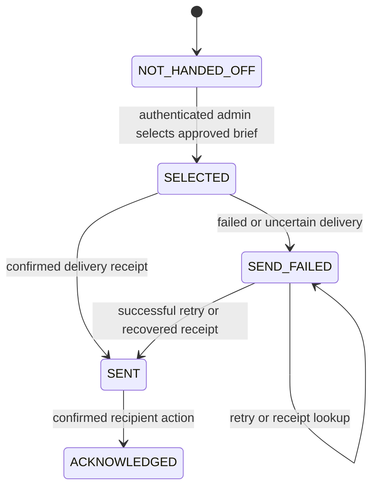

# Backend architecture

Viral Content Hunter is a local Python 3.12 application with FastAPI, Pydantic v2, and the standard-library SQLite driver. The root `pyproject.toml` packages `backend/hunter` and configures tests for invocations from the repository root and `backend/`.

| Owner | Paths | Responsibility |
| --- | --- | --- |
| T1 | `backend/hunter/{db,models,queue,state,interfaces,services,api}`, `config.py` | Persistence, shared contracts, domain transitions, configuration, and API |
| T2 | `backend/hunter/connectors` | Public-source collectors, real connector health, and fingerprint deduplication |
| T3 | `backend/hunter/{orchestrator,ai}` | Scheduling, worker dispatch, CLI adapters, and Claude leader integration |
| T4 | `backend/hunter/{briefs,scoring}` | Brief generation, scoring, clustering and series grouping, Markdown and JSON rendering |
| T5 | `dashboard/` | React and TypeScript admin dashboard consuming the published OpenAPI |
| T6 | `backend/hunter/telegram` | Telegram notifier, deduplication receipts, acknowledgement, and P1 alerts |
| T7 | `backend/hunter/{ingest,pipeline,scheduler,runtime,leader}`, `backend/hunter/api/server.py`, Windows startup and project docs | Ingestion, queue handlers, adaptive scheduling, local server, and operations |

## Running the local server

From the repository root, launch one loopback process with the command below.

```powershell
.venv\Scripts\python.exe -m uvicorn hunter.api.server:app --app-dir backend --host 127.0.0.1 --port 8000 --no-access-log
```

The root app runs API startup and mounts the API at `/api`. Poll `/api/health` for readiness. Built Vite assets come from `dashboard/dist/assets` and dashboard routes such as `/sources` and `/briefs/{id}` serve `dashboard/dist/index.html`. The API stays available when the build is missing and dashboard requests return a JSON `503` with build instructions.

Enable the background runtime in `[runtime]` or set `HUNTER_RUNTIME__ENABLED=1`. It starts queue workers, an adaptive scheduler, periodic retention, and the Telegram tasks. The scheduler uses the shared SQLite queue to collect from enabled public sources, normalize observations, group related articles, and enqueue Gemini drafting. Health appears after the orchestrator observes results from adapter calls. Review remains with the interactive Claude Leader session. The runtime constructs the headless Claude adapter with `enabled=False`.

Register the default public sources explicitly with `python -m hunter.runtime seed-sources`. Existing active entries keep their settings. New entries produce an audit record. Startup never seeds sources.

## Persistence

Call `Database(path).migrate()` before storage access. Startup sets WAL mode, runs numbered SQL migrations in a write transaction, and records each applied version in `schema_migrations`. Every connection enables foreign keys. Domain writes acquire a `BEGIN IMMEDIATE` transaction for changes that must be atomic. Use the APIs below for state changes. Direct access to the local SQLite file is part of the trusted process boundary.

Database timestamps use UTC ISO-8601 with microseconds. Python models normalize aware timestamps to UTC and reject naive inputs. IDs are opaque strings except for integer sequence IDs on decisions, feedback and audit entries.

- `sources` and `connector_status` hold the source registry and last reported status per connector. `OperationsService.save_source`, `remove_source`, `record_connector_health` and `store_raw_item` cover audited source changes, health and observations. Removal hides a source while preserving references and enabling undo.
- `raw_items` holds the observed URL, metadata, fetch time, and captured metrics with a snapshot timestamp when metrics are present. `fingerprints` keys fingerprints by `(kind, digest)` and associates each with a raw item, a brief, or both. T2 owns fingerprint algorithms and the transaction for deduplicated collection.
- `briefs` stores current status, revision count and validated draft content. `brief_revisions` stores submitted snapshots numbered 0, 1 and 2. `review_decisions` links a reasoned decision to its snapshot. `trend_cluster_members` joins clusters to raw items and marks trusted members. `series_episodes` records episode URLs, optional sequence, and an optional raw item link.
- `jobs` and `job_attempts` retain queue state and attempt history. `ai_status` stores observed service availability, last error, and quota state. Report health through `MonitorService.record_ai_health`. Missing health means the adapter has yet to report.
- `handoffs` holds one selection per approved brief, its stable delivery key, and independent send and acknowledgement timestamps. `feedback` records the four admin feedback actions.
- `settings` holds editable dashboard preferences. `audit_log` preserves before and after snapshots, actor, and reason for each source or preference mutation. Undo applies while the current state still matches the recorded result. It writes its own audit entry and repeating the same undo returns that entry. Automated preference adjustments are limited to scan intervals and priority topics. Startup queue and retention limits are loaded from config and exposed read-only to the dashboard.

Startup runs `RetentionService.purge()`. The enabled runtime repeats it every 24 hours. Retention deletes briefs, raw items and fingerprints strictly older than the configured cutoff, 90 days by default. It also deletes linked fingerprints and cascades brief revisions, review history, handoffs, and feedback. Trend and series records and operational history remain available. The Windows backup workflow should apply the same retention policy to managed copies.

## Review workflow



`BriefStore.create()` persists a collected record. Workers use `advance(brief_id, target)` and `submit_draft(brief_id, draft, expected_revision=...)`. Draft content has a Vietnamese summary of 50–100 whitespace-delimited words, a metadata-only disclosure when applicable, and separate scores. The brief view combines that content with the record ID and persisted review and handoff states to expose all 24 product fields.

With `HUNTER_AUTH__CLAUDE_SERVICE_TOKEN` set in its process environment, the Leader can inspect the compact queue with `python -m hunter.leader pending` and read a particular pending draft with `python -m hunter.leader show <brief_id>`. After review, run `python -m hunter.leader decide <brief_id> --action APPROVE --reason "Reason for approval" --revision 0`, using the draft's `revision_count`. The client sends requests only to `/api/review/*` on `127.0.0.1:8000`.

Only `ReviewService.decide()` writes Claude decisions. It checks the expected revision and records the decision and state change atomically. The API exposes this operation only to the Claude service credential. A recorded unavailable or quota-exhausted Claude leaves new results pending. Before any health observation, the separate credential and a valid explicit decision are required. The inbox always filters for `APPROVED_BY_CLAUDE`. P1 alerts must begin from the approved inbox or approved detail lookup. T6 also owns threshold, evidence, verification, freshness, and alert deduplication checks.

## Queue workflow



`PersistentQueue.enqueue(JobInput, available_at=...)` uses a durable idempotency key. The first enqueue owns the key for the lifetime of the job. `claim(worker, worker_id)` chooses an eligible urgent job before a normal job for that worker kind. It acquires the lease and records the attempt in one transaction. Running jobs hold their slots. Concurrency is configurable per worker kind. The default local limit is one slot per four logical CPUs, with at least one slot. A configured zero disables claims for that kind.

Pass the returned job ID and lease token to `heartbeat`, `complete`, or `fail`. Workers should heartbeat before expiry and discard stale completions when they lose the lease. Queue-backed business operations should use their own idempotency keys for effects outside the lease transaction. Startup and later claims reclaim expired leases without resetting attempt counts. Expiry recovery is immediately eligible within the retry limit. Explicit transient failures follow exponential backoff with up to 25% jitter. Three retries follow the initial attempt. A job that requires a paid service ends with `POLICY_BLOCKED` (`BLOCKED (needs paid service)`). An AI quota failure pauses claims for its worker kind until a later health report confirms availability with quota restored.

## Handoff workflow



`HandoffService.select_by_admin` is called only from an authenticated admin action. Selection generates one durable deduplication key. `send` formats the approved brief and serializes concurrent dispatches using a short, persisted lease. After an uncertain result or abandoned dispatch, the service looks up the existing key. It can retry sending once definitive failure is established.

Telegram starts when the dashboard's `telegram_enabled` preference is on and both `TELEGRAM_BOT_TOKEN` and `TELEGRAM_CHAT_ID` are present in the server environment. The runtime owns `getUpdates` for the bot. It records a valid recipient action in the Telegram ledger, answers the callback, updates the message to show `✅ Đã nhận`, and reconciles the handoff row from the ledger. The API's `check-ack` route reads that row. Use a single server process per bot and keep the Telegram smoke poller off while the server is running with that bot.

The Telegram ledger lives beside the configured database as `<database-stem>.telegram.sqlite3`. It keeps delivery reservations, receipts, callbacks, and the polling cursor. The P1 watcher uses the same ledger to suppress repeat delivery for a brief or cluster, including uncertain sends. It considers only approved P1 briefs, applies the dashboard threshold and the 12-hour age limit, and requires a metrics snapshot no older than 30 minutes when discovery is more than 30 minutes old.

## Adapter contracts

Import these protocols and their input and result types from `hunter.interfaces`. Persistence models and enums are exported from `hunter.models`.

| Protocol | Methods and shared types |
| --- | --- |
| `Connector` | Stable `id`, `capabilities: Collection[ConnectorCapability]`, `async fetch(since: datetime \| None, limits: FetchLimits) -> list[RawItem]`, and `health() -> ConnectorHealth`. Raise `ConnectorError` for real fetch failures and report credential-free diagnostics. |
| `AIWorker` | `name: AIName`, `async run(task: AITask) -> AIResult`, and `health() -> AIHealth`. Outcomes are `OK`, `AUTH_LOST`, `QUOTA_EXHAUSTED`, `TIMEOUT`, `UNAVAILABLE`, and `ERROR`. Build successful results with `AIResult.success(task, output)` and validate them at the orchestrator boundary with `validate_for(task)`. Output is an object validated against Draft 2020-12 JSON Schema without remote reference fetching. |
| `Scorer` | `score(items: Sequence[RawItem]) -> ScoringResult` returns independent virality, relevance, credibility, categorical priority, and a human-readable explanation. |
| `BriefDrafter` | `async draft(items, scores, *, feedback=None) -> BriefContent` produces validated Vietnamese content. |
| `BriefReviewer` | `async review(brief: ContentBrief) -> ReviewInput` obtains the Claude decision, reason and revision. Submit it through the review service credential. |
| `Notifier` | `incurs_cost: bool \| None`, `send(message, dedup_key) -> SendResult`, `lookup_send(dedup_key) -> SendResult`, and `check_ack(external_id, dedup_key) -> bool`. Lookup performs no dispatch. `SENT` includes an external receipt. `FAILED` is definitive. `UNKNOWN` preserves delivery uncertainty. |

## Configuration and access

`config/settings.local.toml` is the optional local config. `HUNTER_CONFIG` points to an alternate TOML file. Environment variables override individual fields, including `HUNTER_DATABASE_PATH`, `HUNTER_QUEUE__CLAUDE`, `HUNTER_RETENTION__DAYS`, and `HUNTER_AUTH__CLAUDE_SERVICE_TOKEN`. Relative database paths are resolved from the repository root when launched from inside the checkout. By default, the database lives at `backend/data/hunter.sqlite3`.

| `[runtime]` key | Environment variable | Default |
| --- | --- | --- |
| `enabled` | `HUNTER_RUNTIME__ENABLED` | `false` |
| `scheduler_tick_seconds` | `HUNTER_RUNTIME__SCHEDULER_TICK_SECONDS` | `30` seconds between scheduler ticks and alert scans |
| `telegram_poll_seconds` | `HUNTER_RUNTIME__TELEGRAM_POLL_SECONDS` | `1` second between Telegram polls |
| `dashboard_dir` | `HUNTER_RUNTIME__DASHBOARD_DIR` | `dashboard/dist`, relative to the repository root |
| `dashboard_url` | `HUNTER_RUNTIME__DASHBOARD_URL` | `http://127.0.0.1:8000`, used in Telegram detail links |

`budget.allow_paid_api` is locked to false. Adapters must establish verified zero incremental cost and call `BudgetSettings.require_allowed(incurs_cost=...)` before external I/O. Paid or unknown cost fails closed. AI adapters must use the official subscription-authenticated CLIs and remove API-key and metered-mode variables from child environments. Persist only credential-free error codes or diagnostics.

The dashboard API has no login or admin sessions. `hunter/api/local_guard.py` refuses requests whose `Host` is not loopback and state-changing requests with a non-local `Origin` (CSRF and DNS rebinding). The Claude Leader keeps a distinct service token, which is the only credential the review routes accept, so nothing reachable from the dashboard can approve a brief. The built dashboard calls the mounted API on the same loopback origin. Vite's development proxy forwards `/api` to the local server.
